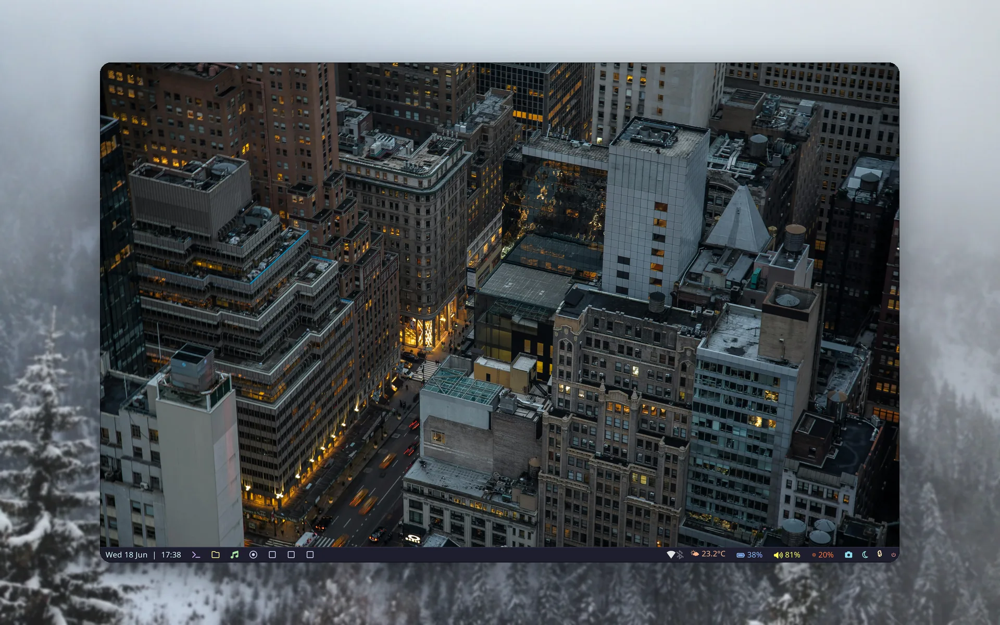
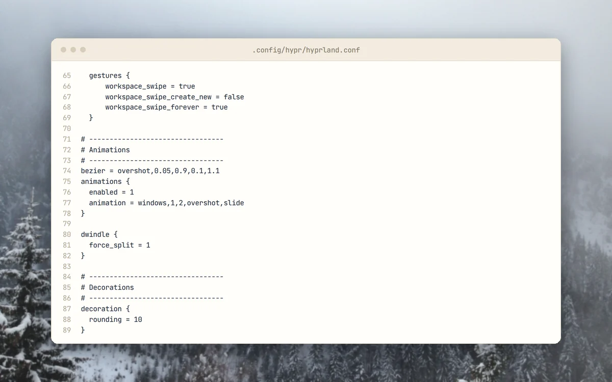
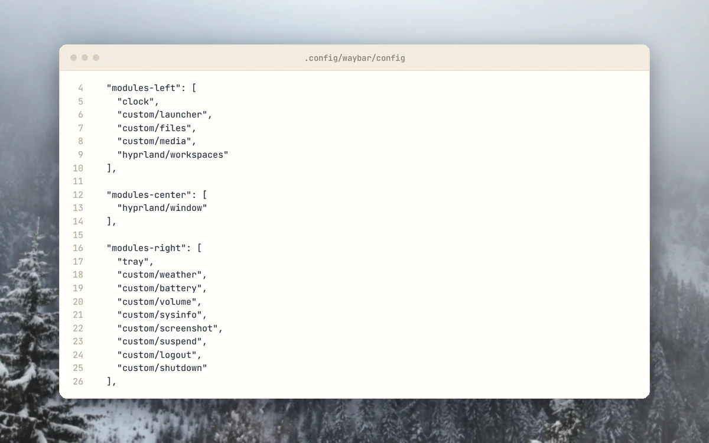
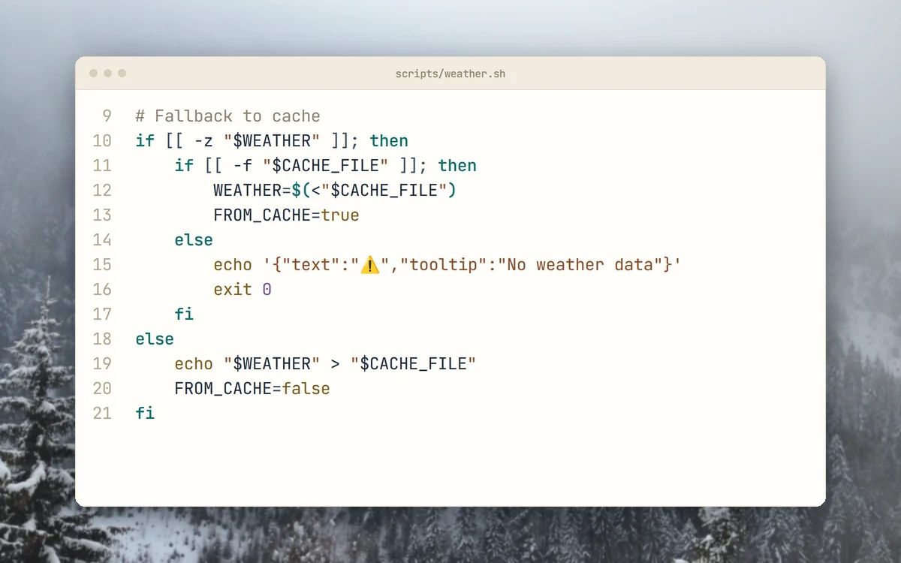

<p align="center">
  <picture>
    <source media="(prefers-color-scheme: dark)" srcset="docs/brand/svg/myarchrice-logo-on-dark.svg">
    
  </picture>
</p>

<h1 align="center">A Hyprland desktop built from scratch. Every script and style sheet is here.</h1>

<p align="center">
  Arch Linux and Hyprland dotfiles, kept as a snapshot from June 2025.<br>
  <b>Hyprland, Waybar, Rofi and the helper scripts behind the bar.</b>
</p>

<p align="center">
  
  
  
  
  <a href="https://github.com/mertkayacs/MyArchRice"></a>
</p>

<p align="center">
  <a href="#quick-start"></a>
  <a href=".config/hypr/hyprland.conf"></a>
  <a href="scripts"></a>
</p>

<p align="center">
  <picture>
    <source media="(prefers-color-scheme: dark)" srcset="docs/assets/readme/hero-dark.webp">
    
  </picture>
</p>

MyArchRice is my Arch Linux and Hyprland desktop, published as dotfiles. It began as a way to learn Linux internals and Wayland compositors from scratch. The repository holds the Hyprland, Waybar and Rofi configuration, GTK and cursor settings, and the scripts that feed the bar. I am moving to Linux Mint, so this build stays here as a snapshot.

---

## Why MyArchRice

One repository holds the whole desktop, from the compositor to the bar scripts.

|  |  |
|---|---|
|  **The full stack** | Hyprland with gestures and window animations, Waybar with its style sheet, and four Rofi themes for the launcher, list launcher, touch launcher and power menu. |
|  **Scripts behind the bar** | Nine shell scripts cover weather from Open-Meteo with a cached fallback, CPU temperature, media status, system info, power menu, idle handling, a music change notifier and a sidebar toggle. |
|  **A readable theme** | The Arc-Blue-sky-Dark GTK theme, Papirus-Dark icons and Catppuccin Mocha cursors are set in [hyprland.conf](.config/hypr/hyprland.conf). |
|  **Touch and keyboard** | Workspace swipe gestures run through libinput-gestures, and the config starts Waybar, dunst, MPD, Bluetooth and network applets at login. |

## A quick tour

<table>
  <tr>
    <td width="50%" valign="top">
      <picture>
        <source media="(prefers-color-scheme: dark)" srcset="docs/assets/readme/tour/desktop-dark.webp">
        
      </picture>
      <h3>The desktop</h3>
      Hyprland with Waybar along the bottom edge, showing the clock, workspaces, weather, battery and volume.
    </td>
    <td width="50%" valign="top">
      <picture>
        <source media="(prefers-color-scheme: dark)" srcset="docs/assets/readme/tour/hyprland-dark.webp">
        
      </picture>
      <h3>Hyprland config</h3>
      Workspace swipe gestures, a sliding window animation, the dwindle layout and rounded corners.
    </td>
  </tr>
  <tr>
    <td width="50%" valign="top">
      <picture>
        <source media="(prefers-color-scheme: dark)" srcset="docs/assets/readme/tour/waybar-dark.webp">
        
      </picture>
      <h3>Waybar modules</h3>
      Clock, launcher, media and workspaces on the left, the active window in the center, and weather, battery, volume and tray on the right.
    </td>
    <td width="50%" valign="top">
      <picture>
        <source media="(prefers-color-scheme: dark)" srcset="docs/assets/readme/tour/weather-dark.webp">
        
      </picture>
      <h3>Weather script</h3>
      A request to Open-Meteo with a two-second timeout, and a cached reading as the fallback.
    </td>
  </tr>
</table>

<p align="center"><sub>The desktop is a screenshot of the running setup. Code cards show the files as they are in the repository.</sub></p>

## Features

**Desktop**

- Hyprland tiling with every window forced to tile, rounded corners and a sliding overshoot animation.
- Wallpaper through swaybg and a clipboard history started at login.

**Waybar**

- Modules for workspaces, CPU, RAM, weather, music and power controls.
- Weather falls back to a cached reading when the network is down.

**Rofi**

- Launcher, list launcher, touch launcher and power menu themes.
- A Spotlight-style script with a web search helper.

## Quick start

Install the packages on Arch Linux:

```sh
sudo pacman -S hyprland waybar kitty rofi dunst thunar swaybg playerctl jq curl brightnessctl pamixer ncmpcpp mpd
```

The theme packages are optional AUR installs:

```sh
yay -S catppuccin-cursors-mocha papirus-icon-theme arc-theme
```

Copy the configuration and reload Hyprland:

```sh
git clone https://github.com/mertkayacs/MyArchRice.git
cd MyArchRice
cp -r .config/* ~/.config/
cp -r scripts Pictures ~/
hyprctl reload
```

### Requirements

- Arch Linux with Hyprland and Waybar.
- The config also starts blueman-applet, nm-applet, libinput-gestures, wl-clipboard-history and megasync. Remove the lines for tools you do not use.
- The weather script has fixed coordinates. Change the latitude and longitude in [scripts/weather.sh](scripts/weather.sh) to your own.

## FAQ

<details>
<summary><b>Is this maintained?</b></summary>

It is a snapshot from June 2025. I moved on to Linux Mint, and the repository stays as a record of this setup.
</details>

<details>
<summary><b>Do I need the AUR packages?</b></summary>

They are optional. Without them the theme settings in hyprland.conf fall back to what you have installed.
</details>

<details>
<summary><b>How do I change the weather location?</b></summary>

Edit the coordinates in `scripts/weather.sh`. It uses Open-Meteo, which needs no API key.
</details>

<details>
<summary><b>Which terminal and launcher does it use?</b></summary>

Kitty opens with SUPER+T and Rofi is the launcher. The repository ships no Kitty or dunst configuration.
</details>

If MyArchRice is useful to you, a ⭐ helps other people find it.

Photos behind the screenshots are credited in [docs/assets/readme/CREDITS.md](docs/assets/readme/CREDITS.md).

[](https://github.com/mertkayacs/MyArchRice)
